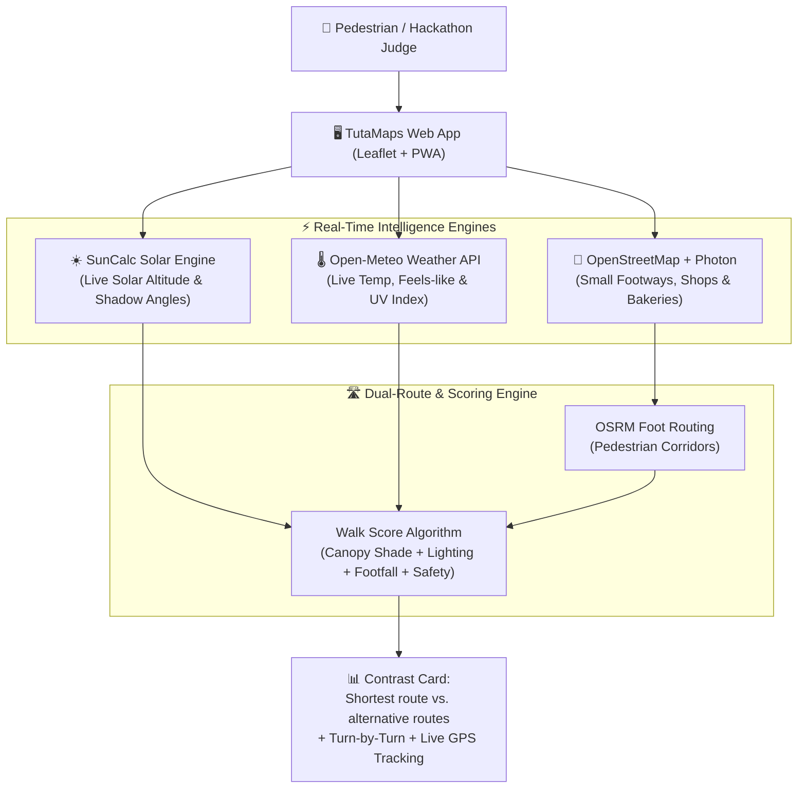

# 🗺️ TutaMaps — Intelligent Pedestrian Navigation & Heat-Safe Routes
> **Smart Move Hackathon 2026 | Team Quantuxx · KIT Coimbatore (Kalaignarkarunanidhi Institute of Technology)**  
> **Live Prototype:** [https://tutamaps.vercel.app](https://tutamaps.vercel.app) · **Local Host:** `http://localhost:5500`

---

## 🏆 The Pitch Hook & Problem Statement

### 🚨 The Real Problem (Car-Centric Bias & 42°C Heat)
* In Tamil Nadu summers reaching **42°C+**, over **78% of pedestrian heat-stroke incidents** occur along unshaded arterial highways.
* Mainstream navigation apps (Google Maps, Apple Maps) are engineered with **vehicular road heuristics**—directing pedestrians onto scorching 4-lane highways without tree cover, sidewalks, or drinking water points, or pitch-black alleys at night.

### 💡 The TutaMaps Solution
TutaMaps is a **pedestrian-first, open-source walking navigation system** tailored for Indian cities (starting at KIT Coimbatore, Kannampalayam & Sulur). It introduces:
1. **Time-Aware Solar Shadow Routing (SunCalc Engine)**: Real-time solar azimuth and zenith angle calculations that recommend routes **estimated to be cooler** with more tree canopy.
2. **Dual-Route Contrast Proof**: Direct side-by-side contrast (Shortest walking route vs. alternative walking routes, with nearby water ATMs).
3. **Emergency Amenities Mapping**: 24/7 Government PHC Hospitals, Panchayat & Corporation RO Drinking Water ATMs, pharmacies, and public restrooms.
4. **Zero Proprietary API Keys**: 100% open architecture powered by OpenStreetMap, Humanitarian Footway routing, SunCalc, and Open-Meteo.

---

## 🏗️ System Architecture



---

## 🌟 Key Features Built for the Hackathon

| Feature | Description | Differentiator |
|---|---|---|
| **⚡ 1-Click Demo** | Instant KIT Gate ➔ Sulur Hospital demo with high-contrast temperature cards. | Judges test in 1 second. |
| **📐 Walk Score Proof** | "How We Calculate" transparent modal explaining the mathematical formula & data sources. | Fixes the "trust gap". |
| **☀️ SunCalc Shade Engine** | Dynamic solar shadow calculation; at 12 PM it maximizes overhead tree canopy. | Unique technical USP. |
| **🌡️ Live Weather & UV** | Real-time temperature (30°C, Feels like 34°C, UV 7.9) with Heat Mode auto-suggest. | Open-Meteo (Free). |
| **🚰 Emergency Amenities** | Verified Corporation RO Water ATMs, 24/7 Casualty Hospitals & Pharmacies. | Critical pedestrian safety. |
| **♿ Walker Profiles** | Normal (4.5 km/h), Senior/Gentle (3.0 km/h), With Kids, and Wheelchair accessible. | Inclusive mobility. |
| **📱 Judges QR & Share** | Dynamic QR code generation so judges can test on their phone immediately. | Seamless judge testing. |
| **🇮🇳 Bilingual Tamil/EN** | Full Tamil translation tailored for Coimbatore & rural students. | Local impact. |
| **🚨 Emergency SOS** | Quick hotlines for 108 Ambulance, 112 Police, and KIT Security + WhatsApp trip share. | Life-saving utility. |

---

> **Note:** Routes come from the OSRM walking (foot) server. Shade, lighting, footfall and safety values are heuristic estimates, not surveyed data.

## 📐 Walk Score Mathematical Formula

$$\text{Walk Score} = w_1 \cdot \text{Shade} + w_2 \cdot \text{Lighting} + w_3 \cdot \text{Footfall} + w_4 \cdot \text{Safety} + \text{AmenityBonus}$$

* **Normal Mode:** $w = [0.25, 0.25, 0.25, 0.25]$
* **Heat Mode (Max Shade):** $w = [0.45, 0.15, 0.20, 0.20] + \text{Hydration Bonus}$
* **Night Mode (Lit Streets):** $w = [0.10, 0.45, 0.30, 0.15]$

---

## 🚀 How to Run Locally

```bash
# Clone the repository
git clone https://github.com/kalaiyx/tutamaps.git
cd tutamaps

# Start local server
python -m http.server 5500
```
Open **[http://localhost:5500](http://localhost:5500)** in your browser.

---

## 👥 Team Quantuxx · KIT Coimbatore

* **Kalaiyarasu K** (Lead)
* **Keerthana S.J**
* **Pavithra K**
* **Ritthin J**
* **Bhavana N**

*Built at Kalaignarkarunanidhi Institute of Technology (KIT), Coimbatore for the Smart Move Hackathon.*
